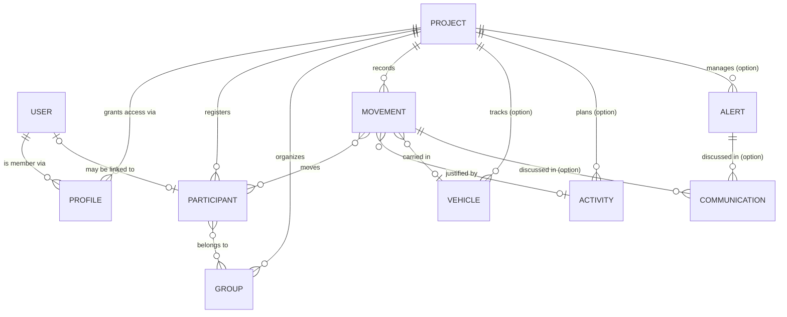

# Domain model

This is Registry's shared vocabulary — the entities the product talks about, their relationships, and the status values that make the live headcount work. It is deliberately business-oriented; the database schema behind it is in [Technical → Data model](/registry/technical/data-model).

## Overview

Everything except users lives **inside a project**. A project is the tenant boundary: two events never share participants, groups, movements or any other resource.

## Entities

### Project {#project}

An event to manage. It has a **name**, an optional **start** and **end** (each being a date with an optional time), and a set of enabled **options**. When both dates are set, a project is _available_ while the current instant falls within the start–end window, and _unavailable_ otherwise; without dates, it is permanently available. Deleting a project (soft delete) grays it out and freezes everything it contains, regardless of its dates; it can be restored or permanently deleted.

### Profile {#profile}

A user's membership of a project. It carries the user's **project role**, an optional **access window** (start/end) and an **invitation status** (`INVITED`, `ACCEPTED`, `REJECTED`). **Blocking** is handled separately, independently of that status: blocking a profile does not touch its invitation status, so on unblocking the profile returns to exactly the state it had (invited, accepted or rejected). `BLOCKED` is therefore only a display and filter label — the interface shows, for example, "Blocked (Accepted)". A profile without an access window is **permanent**; a profile with a window grants permissions only while the current instant falls within it — a member need not be available for the project's whole duration. The project a user is in is simply the one they are viewing: that choice is not remembered.

### User {#user}

Someone who can sign in. Users are **global** — the only entity that does not belong to a project. A user has a name, an email, a **global role**, preferences (theme, language, auto-refresh frequency) and can mark projects as **favorites**. A user can be _blocked_ (they can no longer sign in) or _deleted_ (permanently removed for data protection reasons).

### Participant {#participant}

A person taking part in an event. A participant has a **first name**, a **last name**, a **date of birth**, an optional **availability window** and a **type**:

- **`REGISTERED`** — enrolled for the event. Their normal state is _present_; they generate `OUT` movements when they leave and `IN` movements when they come back. Leaving is not final — unless the movement is explicitly justified as a **definitive departure** (see below).
- **`GUEST`** — a visitor. Their normal state is _off site_; they generate `IN` movements on arrival and `OUT` movements on departure. A guest's departure is always **definitive**: as soon as a guest checks out (`OUT`), they are gone for good — there is no equivalent of a registered participant's temporary absence.

The date of birth mainly serves to **identify a person almost uniquely**: first name, last name and date of birth together are enough to tell two namesakes apart and find the right person if something goes wrong. Incidentally, it feeds the "adults / minors" split and the birthdays panel on the project home page.

A participant can optionally be **linked to a user account** with (past, current or future) access to the project, but most are not users. Alongside their **planned** dates, Registry keeps their **effective** presence dates — their first check-in and their definitive check-out — updated automatically by movements (see [Movements](/registry/functional/features/movements#effective-dates)). A participant's availability window is optional; being present for the whole event is not mandatory — see [Availability windows: priority and date resolution](#availability-windows-priority-and-date-resolution) for what applies when it is not set.

### Group {#group}

A named set of participants — a team, a unit, a tent. A group can have **zero, one or several members**, never a guest. Its own availability window is optional (see [Availability windows](#availability-windows-priority-and-date-resolution)); it serves to **move and count people together**: selecting a group in a movement expands it into its members. Registry tracks how many members are currently inside or outside.

### Movement — the core record {#movement-the-core-record}

A **check-in or check-out event**. Each movement has:

- a **timestamp** ("now" by default);
- a **direction** — `IN` or `OUT`;
- a **content type** — `REGISTERED` or `GUEST`;
- a **set of participants** (picked directly or by expanding groups), each optionally assigned to a **vehicle**;
- a **pool label** on each participant entry — plain text that carries the name of the group (in whole or in part) expanded to produce it. It has nothing to do with the vehicle or with carpooling. Since a movement may contain only part of a group, it records each participant individually anyway, not a reference to the group. The label is deliberately text rather than a link to the group: checking that each participant of a pool really belongs to the group would be slow and costly, for no benefit — an inconsistency there has no consequence. This choice also leaves the door open to pools created directly in a check-out, with just a name, through interface-only changes;
- a **justification** — either a **reason** picked from a fixed list (see [Status vocabulary](#status-vocabulary)) or a linked **activity** (never both), whenever the movement takes a participant out of their normal state. When a movement simply **brings** someone back to their normal state (a registered participant coming back `IN`, or a guest leaving `OUT`), the justification is not merely optional or left empty — **there is simply no reason/activity field to fill in** for that movement.

Movements are what the dashboard reads to compute presence. They are _log_-type items: each change **keeps the previous version**. A definitive departure remains correctable: a registered participant's can be edited like any other movement, a guest's only on its date (a guest has only one arrival and one departure, changing anything else would make no sense); both can be deleted. Correcting or deleting a definitive departure, or a first arrival, recomputes the participant's **effective** presence dates. A special reason, the **definitive departure**, marks a _registered_ participant as gone for good — the state a guest reaches automatically with every `OUT`.

### Vehicle _(option)_ {#vehicle-option}

A vehicle available to the event: **license plate**, **make**, **model**, and an optional availability window (see [Availability windows](#availability-windows-priority-and-date-resolution)). Like participants, a vehicle is _inside_ or _outside_ according to its last movement, which feeds the dashboard's vehicle presence card.

### Activity _(option)_ {#activity-option}

A planned activity or outing: **name**, **description**, a **duration**, an optional availability window (see [Availability windows](#availability-windows-priority-and-date-resolution)) and an **allowed participant range** (minimum/maximum). An activity can serve as a movement's reason, linking a check-out to the people who took part in it.

An activity does not behave like a participant or a vehicle. Think of a **film** and its **screenings**: the film "Lake hike" can be shown several times, and even in several theaters at once; each movement that uses it as a reason is one more screening. A participant or a vehicle, on the other hand, is like a **viewer**: there is only one of them and they can only be in one theater at a time. That is why an activity has no presence status (inside/outside), unlike participants and vehicles.

### Communication _(option)_ {#communication-option}

A timestamped **message** (250 characters at most) linked to a **registered check-out** (itself optionally linked to an activity) and/or to an **alert**, or directly creating an alert. Communications form the discussion thread, displayed as a chat, around an operational event. They are _log_-type items, versioned on every change.

### Alert _(option)_ {#alert-option}

An **incident**: a **title** (50 characters at most), a **timestamp**, a **status** (`IN_PROGRESS`, `RESOLVED`, `CANCELED`) and a **criticality** that increases with its age while it is in progress. An alert is created with a first message, then tracked until it is resolved with its own communication thread. Only an in-progress alert can be edited; each change or status change is versioned.

## Availability windows: priority and date resolution {#availability-windows-priority-and-date-resolution}

Every availability window in Registry — project, participant, group, vehicle, activity — and every profile's access window share the same shape: an optional **start** and **end**, each being a date with an optional time. But they do not all resolve the same way, and dates matter enough in Registry to be spelled out.

### Priority: the most specific item wins

Dates are read **from the most specific to the least specific**:

- A **participant** with planned presence dates set overrides any less specific date (those of their groups).
- A **participant** without planned dates refers to the dates of their **group(s)**; if they belong to several groups, they are available as soon as **one** of them covers the instant in question.
- A **group**, an **activity**, a **vehicle** or a **profile** with dates set refers to those dates.
- If a date is not set, the item above is used (the groups, for a participant). If there is no item above — the case for groups, vehicles, activities and profiles — the item is considered **perpetually available**.

The **project** is not a fallback level for anyone: its dates only bound data entry (item dates must stay within the project's period, except for profiles). Changing a project's dates is refused if existing items would fall outside the new period.

The **profile** is deliberately independent of its project: access can be granted before opening or after closing (setup or wrap-up teams).

### Interpreting a date without a time {#date-without-time}

A window's start or end can be given as a date without a time — but never the reverse: a time supplied without a date is rejected. When both bounds are set, the start must be strictly before the end.

When a bound is a plain date:

- a **start** date is interpreted as `00:00:00.000`;
- an **end** date is interpreted as `23:59:59.999…` (end of day);
- both are resolved in **the same time zone as the instant they are compared with** — not a fixed zone — so a project opening on "2026-07-10" means midnight local time for whoever's request is being evaluated, not midnight UTC.

## Status vocabulary {#status-vocabulary}

These are the enumerations that appear throughout the product.

| Enumeration | Values | Meaning |
| --- | --- | --- |
| **Movement type** | `IN`, `OUT` | Direction of a check-in/check-out. |
| **Participant type** | `REGISTERED`, `GUEST` | Registered participant or visitor — they move in opposite directions. |
| **Presence status** | `IN`, `OUT`, `UNAVAILABLE`, `OVERDUE` | The live state of a participant or a vehicle, derived from movements and the availability window. `OVERDUE` only concerns participants: they have arrived, have not definitively left, and their planned end has passed. |
| **Availability status** | `AVAILABLE`, `UNAVAILABLE` | Whether a project, participant, group, vehicle, activity or profile is within its active window — its own if set, otherwise inherited (see [Availability windows: priority and date resolution](#availability-windows-priority-and-date-resolution)). |
| **Profile status** | `INVITED`, `ACCEPTED`, `REJECTED`, `BLOCKED` | Lifecycle of a project invitation. `BLOCKED` is never stored: it is the label shown for a blocked profile, which keeps its original status (see [Profile](#profile)). |
| **Alert status** | `IN_PROGRESS`, `RESOLVED`, `CANCELED` | Lifecycle of an incident. |
| **Alert criticality** | `RECENT`, `REINFORCED`, `HIGH` | Age of an in-progress alert (by default reinforced after 6 h, high after 18 h). |
| **Refresh mode** | `OFF`, `ECO`, `NORMAL`, `FAST` | A user preference: how often the displayed data reloads on its own. |
| **Movement reason** | `EMERGENCY`, `LOGISTICS`, `PARTNER_ANIMATION`, `VISIT`, `SHOPPING`, `MEDICAL`, `DEFINITIVE_DEPARTURE`, `OTHER` | Why a movement happened. Each reason is only valid for a given direction and participant type. |
| **Project option** | `VEHICLE`, `ACTIVITY`, `COMMUNICATION`, `ALERT` | The optional modules an event can enable. |
| **User type** | `USER`, `SERVICE_ACCOUNT` | A human account or the system's own job runner. |
| **Theme** | `SYSTEM`, `LIGHT`, `DARK` | A user's interface preference. |

### How reasons pair with direction and type {#how-reasons-pair-with-direction-and-type}

A movement's reason must be consistent with its direction and the participant type — this is enforced, not just advised:

| Reason | Applies to | Direction |
| --- | --- | --- |
| `SHOPPING`, `MEDICAL`, `DEFINITIVE_DEPARTURE`, `OTHER` | Registered participants leaving | `OUT` |
| `EMERGENCY`, `LOGISTICS`, `PARTNER_ANIMATION`, `VISIT` | Guests arriving | `IN` |

A registered participant with no reason or activity is assumed to be **coming back** (`IN`); a guest with no reason is assumed to be **leaving** (`OUT`). The [Movements feature](/registry/functional/features/movements) details these rules.
