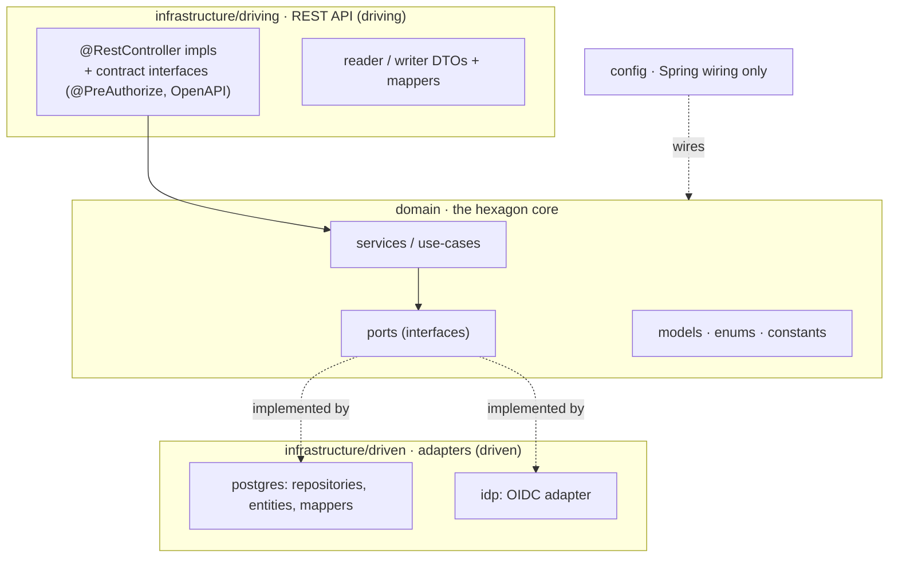
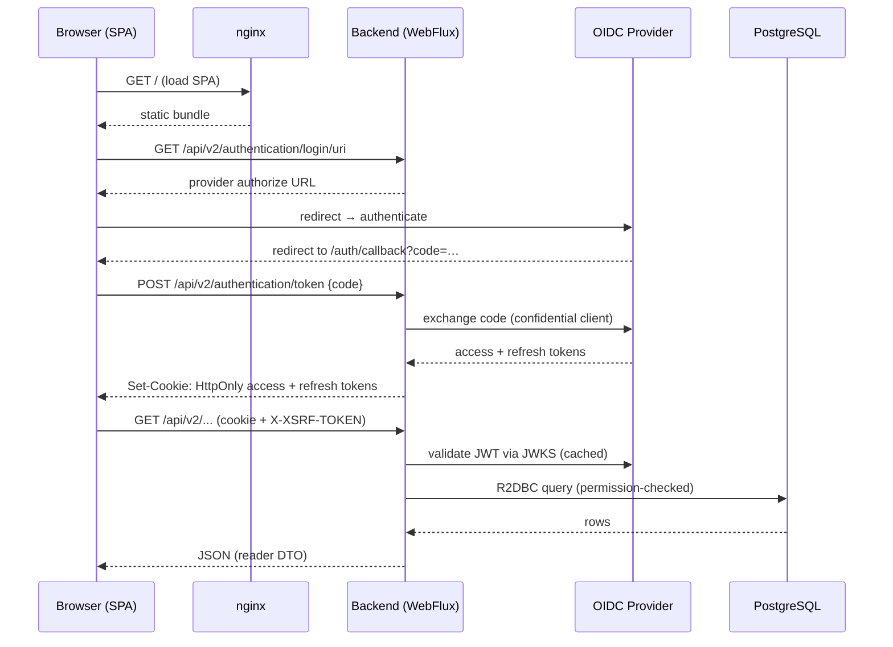

# Architecture

Registry consists of two deliverables — a reactive Kotlin backend and an Angular SPA — that talk over a versioned REST API, with an external OIDC provider and a single PostgreSQL database behind the backend. This page describes the internal shape of each service and the end-to-end path of a request.

## Backend — hexagonal, reactive

The backend follows **hexagonal architecture (ports and adapters)**. The domain is at the center: it depends neither on the adapters (`infrastructure/`) nor on the wiring (`config/`), and it is the periphery that speaks HTTP, SQL and OIDC. The dependency rules are not a convention — they are **checked by an ArchUnit test** run with the test suite ([ADR 001](/registry/technical/adr/001-hexagonal-architecture)).

### Layers

- **`domain/`** — the core: `model/` (business models, exceptions, pagination), `port/` (interfaces of the outbound ports the domain depends on), `service/` split into `core/` (a resource's rules), `usecase/` (orchestrations that span several resources) and `support/` (audit, translation, cache, features), `helper/` (reusable rules), plus `enumeration/`, `constant/` and the `extension/` reactive helpers. The domain depends on no web adapter (`org.springframework.web`, `http.server`, `security.web` — forbidden by ArchUnit), but it is not Spring-independent: its services are beans (`@Service`, `@Component`), its writes go through `TransactionalOperator`, its signatures are `Mono`/`Flux` (Reactor), `RegistryException` carries an `HttpStatus`, and the principal (`CurrentUserModel`) relies on Spring Security types.
- **`infrastructure/driving/`** — the **REST API** (the "driving" side, facing outwards — called by the outside world), the security chain (filters, limiters, read auditing) and the scheduler. Controllers are **contract-first**: the REST semantics — path mapping, `@PreAuthorize`, OpenAPI tags, validation, `@AuthenticationPrincipal CurrentUserModel` — live on an interface (`I…V2Controller`); the `@RestController` implementation only delegates to a domain UseCase, or directly to a `support/` service. A `core/` service never calls another `core/` service or a UseCase, and a UseCase is only called by controllers. Incoming _writer_ DTOs and outgoing _reader_ DTOs are mapped to/from the domain models, and API-specific validation constraints live here.
- **`infrastructure/driven/`** — the **outbound adapters** that serve the domain (called by the application): `postgres/` (R2DBC repositories implementing the domain ports, entities, entity mappers) and `idp/` (the OIDC provider adapter).
- **`config/`** — Spring wiring only (security, CORS, documentation, R2DBC, i18n, Swagger, logging, JWT decoder, clock, features).

### Reactive top to bottom

Every layer is non-blocking: WebFlux controllers return `Mono`/`Flux`, repositories use the reactive **R2DBC** driver, and writes run in reactive transactions (`TransactionalOperator`) with programmatic R2DBC auditing. Schema management is the only exception — **Flyway** migrates the database over a JDBC connection at startup, so the backend opens two connections to the same database: an R2DBC pool for the runtime and JDBC for migrations ([ADR 002](/registry/technical/adr/002-reactive-webflux-r2dbc)). Repositories write SQL by hand via Spring Data's `@Query`, composing reusable fragments (join clauses, visibility/project filters) to stay DRY, and assemble `PageModel` results from a count query and a page query.

### Cross-cutting concerns

- **Errors** — a `RegistryControllerAdvice` turns `RegistryException`, validation failures and framework exceptions into a localized `ErrorDto` (status, code, i18n title/message).
- **Validation** — Jakarta Bean Validation with per-field length and size bounds on every writer DTO and every request parameter, plus a family of custom cross-field constraints (`@StartBeforeEnd`, `@MinUpperMax`, `@MovementReason`, `@BothCannotBeDefined`, `@AtLeastOneIsDefined`, `@MovementGuestContent`, `@DateDefinedForTime`, `@ProjectOptionDependencies`, `@ProfileAcceptOrReject`), evaluated by a reflection-based `GenericValidator` that lives with the API layer.
- **i18n** — the request locale, from the `Accept-Language` header, drives the `messages`/`errors` bundles (English by default, French supported).
- **Pagination** — the API takes `page` (≥ 0, 0 by default) and `size` (bounded 1–200, 20 by default) with `q` and `sort`, mapped to the domain's `PageableModel(offset, limit)`; a `PageModel` (content + page metadata) comes back, assembled from a count query and a page query.
- **Concurrency** — `ETag`/`If-Match` plus row locks protect concurrent edits and "last administrator"-style invariants ([ADR 016](/registry/technical/adr/016-optimistic-concurrency-and-row-locks)).
- **Scheduling** — an internal `PurgeScheduler` runs the five nightly retention sweeps ([ADR 010](/registry/technical/adr/010-scheduled-retention-purges)).
- **Traceability** — a filter traces reads of personal data and exports in an audit log written in the background ([ADR 019](/registry/technical/adr/019-personal-data-access-audit)); _log_-type items are versioned on every change ([ADR 018](/registry/technical/adr/018-log-history-versioning)).
- **Observability** — Spring Actuator with a Micrometer/Prometheus endpoint, enabled by feature flag per environment.

## Frontend — zoneless Angular, signal stores

The frontend is an **Angular SPA** bootstrapped by `bootstrapApplication` on a standalone root component, with **zoneless** change detection driven by signals (`provideZonelessChangeDetection`). The interface relies on the `@sgdf/ui` design system and Tailwind CSS. See [Frontend](/registry/technical/frontend) for the full picture.

- **Bootstrap and runtime configuration.** Before the application bootstraps, an initializer fetches two JSON files — `settings/config.json` (application identity, languages, notification durations) and `settings/env.json` (backend URL, production flag, unauthenticated paths, hosting provider). `config.json` is versioned; `env.json` is not and is injected per environment (`config.json` can be too), so a single built image serves any environment ([ADR 007](/registry/technical/adr/007-frontend-runtime-config)).
- **Folder taxonomy.** `core/` contains what the application cannot run without (configuration, authentication, layout, routing, session state); `pages/` contains one folder per routed page with its own `data/` (api, store, facade, DTOs); `shared/` contains directives, helpers, mappers, models and reusable UI.
- **State management.** `@ngrx/signals` signal stores behind facades — `component → facade → store → api` ([ADR 013](/registry/technical/adr/013-signal-stores-and-facades)). Core stores are root singletons; page stores are provided by their routes and reset on a profile change. The "active project" is the route's `:projectId`, not a stored preference.
- **HTTP and authentication.** A single functional interceptor sends every backend request with `withCredentials` (the `HttpOnly` authentication cookies travel automatically, except on public metadata lookups), relays the `X-XSRF-TOKEN` header captured on the previous authenticated response, adds `Accept-Language`, refreshes the token once on `401` then replays the request, and normalizes transport errors into user-facing messages.
- **Routing and guards.** Each page is loaded on demand behind an `authGuard`; `userAuthorityGuard` protects the user directory; a `projectContextGuard` selects the `:projectId` project (and answers a single generic "not found" when the user has no access to it), and `projectOptionGuard(option)` mirrors the backend's per-project option authorities for the vehicle, activity and alert modules.
- **Freshness.** A `RefreshService` reloads the displayed data in the background at an interval set by the user's refresh mode (`OFF`/`ECO`/`NORMAL`/`FAST`); optimistic concurrency uses `ETag`/`If-Match` ([ADR 016](/registry/technical/adr/016-optimistic-concurrency-and-row-locks)).

## End-to-end path of a request

The [Security](/registry/technical/security) page details the JWT → user mapping and how the per-project permission check runs on every call.

## Deployment topology

Four cooperating tiers:

1. **PostgreSQL** — the single source of truth; schema managed by Flyway.
2. **OIDC provider** — issues and signs JWTs; configured generically (see [ADR 004](/registry/technical/adr/004-oidc-resource-server-auth)).
3. **Backend** — distroless Java image, non-root, exposing `/api/v2/**` on `:8081` (authenticated by JWT/cookie, CORS restricted to a configured allowlist) and, on a separate, unauthenticated **management port** `:8082`, health, Prometheus metrics and (optionally) OpenAPI — see [Security → Network exposure](/registry/technical/security#network-exposure-the-management-port).
4. **Frontend** — the static bundle served by an unprivileged nginx on `:8080`, with SPA fallback and hardening headers; configured per environment through the two runtime JSON files.

Both services are versioned by semantic-release and published as container images with a retention policy of 5 ([ADR 009](/registry/technical/adr/009-container-delivery-semantic-release)).
