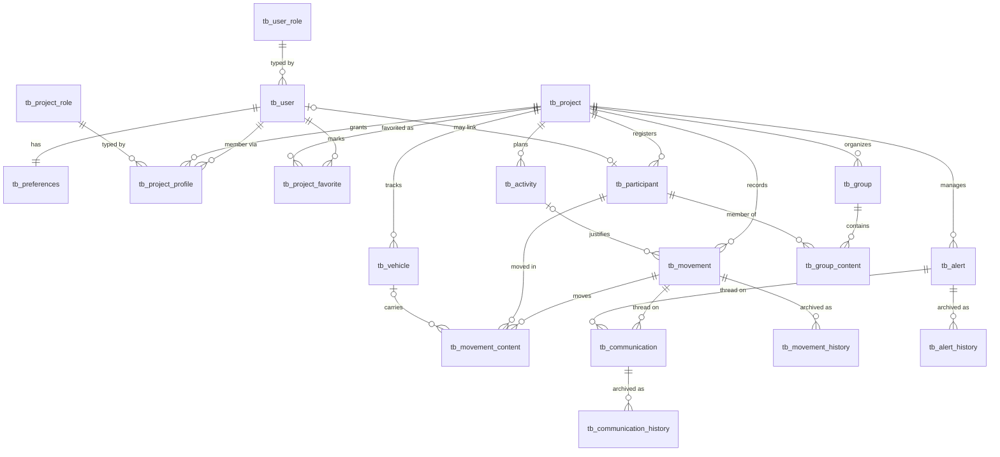

# Data model

Registry stores everything in a single PostgreSQL database. The schema is managed by **Flyway migrations** (from `V1_0_0` to `V1_29_0`), applied at startup; runtime access is reactive via **R2DBC**. This page is the physical-schema counterpart of the business-oriented [Domain model](/registry/functional/domain-model).

## Overview of entity relationships

All tables except `tb_user`, `tb_preferences`, `tb_audit` and the RBAC tables carry a `project_id` foreign key — **the project is the tenant boundary**, and most foreign keys to a project cascade on delete.

## Conventions

- **Primary keys** are UUIDs.
- **Auditing.** Every domain table has `created_date`, `created_by`, `last_modified_date`, `last_modified_by` (the `*_by` columns reference `tb_user`), filled in by R2DBC auditing.
- **Soft delete.** A `visible BOOLEAN` column implements soft delete / restore (or block / unblock for users and profiles). A "soft" delete never removes a row; it flips `visible`, which the authority model reads for [visibility filtering](/registry/technical/security#visibility-gating).
- **Separate date/time.** Windows and event times are stored in distinct `_date DATE` and `_time TIME WITH TIME ZONE` columns (the domain models them as `CustomDateTime`), so a value can be a plain date.
- **Trigram search.** Searchable tables carry a `STORED GENERATED search_text` column with a `gin_trgm_ops` GIN index — see [below](#search).

## Tables

### Identity and preferences

| Table | Key columns | Notes |
| --- | --- | --- |
| `tb_user` | `oidc_id` (unique), `type` (`USER`/`SERVICE_ACCOUNT`), `first_name`, `last_name`, `email` (unique), `role` → `tb_user_role`, `birthday`, `last_login`, `visible` | Global identity. `visible=false` means blocked. Accounts are deleted for good (the former `purged` anonymization flag was removed in `V1_16_0`). A partial unique index enforces a single `SERVICE_ACCOUNT`. `search_text` = name + email. |
| `tb_preferences` | `user_id` (unique) → `tb_user` (cascade), `theme`, `language`, `refresh_mode` | One row per user; interface preferences only. `refresh_mode` (`OFF`/`ECO`/`NORMAL`/`FAST`, `NORMAL` by default) sets the automatic data refresh frequency. The active profile column was removed in `V1_14_0`. |

### Project and membership

| Table | Key columns | Notes |
| --- | --- | --- |
| `tb_project` | `name`, `begin_date`/`begin_time`, `end_date`/`end_time`, `options TEXT[]` | The tenant root. `options` lists the enabled modules (`VEHICLE`, `ACTIVITY`, `COMMUNICATION`, `ALERT`). |
| `tb_project_favorite` | `user_id` → `tb_user` (cascade), `project_id` → `tb_project` (cascade), `created_date` | A user's favorite projects; unique per (`user_id`, `project_id`). Added in `V1_19_0`. |
| `tb_project_profile` | `user_id` → `tb_user` (cascade), `project_id` → `tb_project` (cascade), `role` → `tb_project_role` (cascade), `status`, `start_access_*`/`end_access_*` | A user's membership: role, invitation `status` (`INVITED`/`ACCEPTED`/`REJECTED`/`BLOCKED`) and access window. |

### Participants and groups

| Table | Key columns | Notes |
| --- | --- | --- |
| `tb_participant` | `first_name`, `last_name`, `birthday` (not null), `type` (`REGISTERED`/`GUEST`), `user_id` → `tb_user` (set null), `project_id` (cascade), `start/end_availability_*`, `effective_arrival`, `effective_departure` | A person at the event, optionally linked to a user. The effective dates are the first check-in and the last definitive check-out (or a guest's last check-out) taken from movements, maintained when movements change (`V1_18_0`). `search_text` = name. Presence status is derived from movements, not stored; the effective dates are the only stored derivation. |
| `tb_group` | `name`, `project_id` (cascade), `start/end_availability_*` | A named set of participants. |
| `tb_group_content` | PK (`group_id`, `participant_id`), both cascading | Many-to-many group ↔ participant relationship. |

### Movements (core)

| Table | Key columns | Notes |
| --- | --- | --- |
| `tb_movement` | `date_time`, `type` (`IN`/`OUT`), `project_id` (cascade), `activity_id` → `tb_activity`, `reason` | A check-in/check-out event, justified either by a `reason` or by an `activity_id` (never both). |
| `tb_movement_content` | PK (`movement_id`, `participant_id`), `pool_name` (nullable `VARCHAR`), `vehicle_id` → `tb_vehicle` | The people moved. `pool_name` is the name of the group expanded to produce this entry, frozen at recording time; it is `NULL` for a participant added individually, and is independent of `vehicle_id`. |

### Optional modules

| Table | Key columns | Notes |
| --- | --- | --- |
| `tb_vehicle` | `license_plate`, `brand`, `model`, `project_id` (cascade), `start/end_availability_*` | `search_text` = plate + make + model. Presence derived from movements. |
| `tb_activity` | `name`, `description`, `duration`, `min_allowed_participants`, `max_allowed_participants`, `project_id` (cascade), `start/end_availability_*` | Usable as a movement reason. `search_text` = name + description. |
| `tb_communication` | `date_time`, `message`, `movement_id` → `tb_movement` (cascade, nullable), `alert_id` → `tb_alert` (set null), `project_id` (cascade) | A message attached to a movement and/or an alert (at least one of the two). |
| `tb_alert` | `date_time`, `title`, `status` (`IN_PROGRESS`/`RESOLVED`/`CANCELED`), `project_id` (cascade) | An incident with its own communication thread. |

### _Log_ history

Before each change to a _log_-type item, its previous state is copied into a history table ([ADR 018](/registry/technical/adr/018-log-history-versioning)).

| Table | Key columns | Notes |
| --- | --- | --- |
| `tb_movement_history` | `movement_id` (cascade), `version`, `archived_date`, copy of the movement's fields | Unique per (`movement_id`, `version`). |
| `tb_movement_content_history` | `movement_history_id` (cascade), `participant_id`, `vehicle_id`, `pool_name` | The movement's content at that version. |
| `tb_alert_history` | `alert_id` (cascade), `version`, `archived_date`, copy of the title, status and date | Status changes are archived too. |
| `tb_communication_history` | `communication_id` (cascade), `version`, `archived_date`, copy of the message and links | — |

### Audit

| Table | Key columns | Notes |
| --- | --- | --- |
| `tb_audit` | `action` (`READ`/`EXPORT`), `resource_type` (`USER`/`PARTICIPANT`/`MOVEMENT`), `resource_id`, `project_id`, `actor_user_id`, `outcome` (`SUCCESS`/`FORBIDDEN`/`RATE_LIMITED`), `client_ip`, `user_agent`, `occurred_at` | Trace of access to personal data ([ADR 019](/registry/technical/adr/019-personal-data-access-audit)). Deliberately **without foreign keys**: the trace survives the deletion of the actor or the resource, until its own purge. Indexed by actor, by resource and by date. |

### RBAC (roles and permissions as data)

Two parallel sets of three tables encode the [two permission planes](/registry/functional/roles-and-permissions#two-permission-planes):

| Global plane | Project plane | Purpose |
| --- | --- | --- |
| `tb_user_permission (name)` | `tb_project_permission (name)` | The catalog of permission names. |
| `tb_user_role (name, level)` | `tb_project_role (name, level)` | The roles, with a numeric `level` (lower = more powerful). A partial unique index enforces exactly one level-0 role. |
| `tb_user_role_permission (role, permission)` | `tb_project_role_permission (role, permission)` | The role → permission mapping. |

Each resource has its create, read, update and permanent delete permissions, plus dedicated **soft delete** and **restore** permissions (`V1_28_0`, [ADR 017](/registry/technical/adr/017-soft-delete-and-restore-permissions)), history and metadata permissions. These rows are injected by the `_roles` migrations and loaded into memory at startup; changing them is a data operation (and a restart) rather than a code change ([ADR 005](/registry/technical/adr/005-db-driven-project-rbac)).

## Search {#search}

`V1_4_0` adds fuzzy search without a separate search engine ([ADR 006](/registry/technical/adr/006-flyway-trigram-search)):

- the `pg_trgm` extension is enabled;
- `tb_user`, `tb_participant`, `tb_vehicle` and `tb_activity` each gain a `STORED GENERATED` `search_text` column that concatenates their human-identifying fields;
- each `search_text` gets a **GIN `gin_trgm_ops`** index for fast substring/approximate search.

Result set sizes are bounded by configuration to keep search cheap.

## Migration history

| Migration | Adds |
| --- | --- |
| `V1_0_0` / `V1_0_1` | Initial structure; base user roles |
| `V1_1_0` / `V1_1_1` | Groups; group roles |
| `V1_2_0` / `V1_2_1` | Vehicles; vehicle roles |
| `V1_3_0` / `V1_3_1` | Activities; activity roles |
| `V1_4_0` | Trigram search columns and indexes |
| `V1_5_0` | Movement reason |
| `V1_6_0` | Guest participant type |
| `V1_7_0` / `V1_7_1` | Communication structure; communication roles |
| `V1_8_0` / `V1_8_1` | Alert structure; alert roles |
| `V1_9_0` | Scheduled job (purge) role |
| `V1_10_0` | Preference improvements |
| `V1_11_0` | Removal of the service account's email |
| `V1_12_0` | Fix of the activity indexes (moved from `tb_vehicle` to `tb_activity`) |
| `V1_13_0` | Trigram search on alert titles and communication messages |
| `V1_14_0` | Removal of the active profile stored in preferences |
| `V1_15_0` | Removal of the `REGISTRY_PROJECT_METADATA_R` permission (options moved to the public metadata API) |
| `V1_16_0` | Removal of anonymization: deletion of anonymized rows, removal of `purged` |
| `V1_17_0` | `REGISTRY_PROJECT_PARTICIPANT_EXPORT` permission (project administrators) |
| `V1_18_0` | Participants' effective arrival and departure dates (back-computed from movements) |
| `V1_19_0` | Project favorites |
| `V1_20_0` | Index on movements (`project_id`, `date_time`) |
| `V1_21_0` | Search indexes on movement and group content by participant |
| `V1_22_0` | Preferences refresh mode |
| `V1_23_0` | Coordinators lose permanent deletion of movements |
| `V1_24_0` | Indexes on foreign keys (a movement's activity and vehicle, a communication's alert) |
| `V1_25_0` | History tables for movements, alerts and communications |
| `V1_26_0` | Audit table for access to personal data |
| `V1_27_0` | Index on lowercase email (exact search for a user to invite) |
| `V1_28_0` | Soft delete and restore permissions, for users and each project resource |
| `V1_29_0` | Unlinks participants attached to a user who has no profile on their project |

> Migrations are forward-only. Any new schema change goes into a new `V…` file, never by editing an already applied migration.
