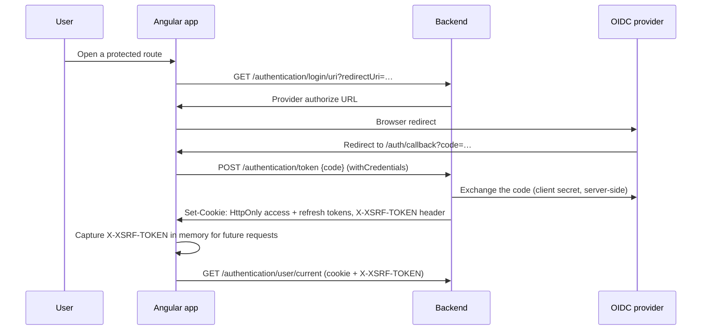

# Frontend

`Registry-Frontend` — an Angular single-page application (SPA), served as static files and configured at runtime. The
backend owns the session (in `HttpOnly` cookies the frontend never reads); the SPA only mirrors
the backend's authorization for the interface, and enforces nothing.

## Tech stack

| Concern         | Choice                                                                                                                    |
| --------------- | ------------------------------------------------------------------------------------------------------------------------- |
| Framework       | Angular, standalone components, **zoneless**, client-side rendering only                                                  |
| Language        | TypeScript, `no-explicit-any` and explicit return types as errors                                                         |
| UI              | [`@sgdf/ui`](https://gitlab.com/sgdf/projets-benevoles/sgdf-ui/) (web components based on Web Awesome)                    |
| Styling         | Tailwind CSS for layout and spacing only; native CSS for the rest; no Bootstrap                                           |
| State           | `@ngrx/signals` `signalStore`, exposed through facades ([ADR 013](/registry/technical/adr/013-signal-stores-and-facades)) |
| Forms           | Signal Forms (`@angular/forms/signals`)                                                                                   |
| i18n            | Transloco, `fr` and `en` bundles in `public/i18n`                                                                         |
| Tests           | Vitest, Component Harnesses, coverage thresholds enforced in `angular.json`                                               |
| Package manager | pnpm                                                                                                                      |
| Lint            | ESLint with angular-eslint                                                                                                |
| Serving         | nginx-unprivileged, port 8080                                                                                             |

## Application shape

```text
src/app/
  core/                 What the application cannot run without
    authentication/       guards, the HTTP interceptor, the security api
    browser/              BrowserService — the only door to window, document, location
    config/               runtime configuration (config.json + env.json), translation loader
    language/             LanguageService
    layout/               shell, navigation bar, footer, confirmation dialog, global error
    registry/state/       session, UI, notification and user profile stores and facades, shared apis
    routing/              registry.routes.ts and the route enums
    seo/                  title strategy and search metadata
  pages/                The pages, organized strictly by routing path
    home/                 global home (widgets)
    login/ auth/callback/ privacy/ terms/
    my-account/           preferences, invitations
    users/                directory (administrators)
    projects/             list, form, and :projectId/ …
      [projectId]/          project home, movements, alerts, participants, vehicles, configuration/
  shared/               Neither core nor a page
    directives/ helpers/ mappers/ models/ ui/
```

### Where to put what

A domain that cuts across the whole application (authentication, configuration, language, theme) lives in `core/<domain>/`;
a domain specific to a routed page's data lives in that page's `data/` folder.

| Item                                      | Location                                                                                                                                                                                           |
| ----------------------------------------- | -------------------------------------------------------------------------------------------------------------------------------------------------------------------------------------------------- |
| Api, store and facade of a page's domain  | `pages/<page>/data/state/` (`<domain>.api.ts`, `<domain>.store.ts`, `<domain>.facade.ts`); the store's state model in `data/model/`                                                                |
| Api, store and facade of the core domains | `core/registry/state/` (session, UI, notifications, the user's profiles, shared apis)                                                                                                              |
| DTOs                                      | responses in `shared/models/dto/response/` (`<name>.response.dto.ts`); requests in `shared/models/dto/`, or in `pages/<page>/data/dto/` when a single page sends them                              |
| Models and enumerations                   | `shared/models/model/` and `shared/models/enumeration/`                                                                                                                                            |
| Mappers                                   | `shared/mappers/`: a `<Name>Mapper`, an `as const` object exposing `toModel`, which only converts a DTO into a model (or the reverse); each `*.api.ts` passes its responses through it             |
| Helpers                                   | `shared/helpers/`: `as const` objects that compute (dates, durations, ages, `ETag`…); the generic building blocks of apis, stores and facades are in `shared/helpers/api/`, `store/` and `facade/` |
| Technical services                        | in the core domain they serve (`BrowserService`, `LanguageService`, `MenuService`), or in `shared/helpers/` when they are cross-cutting (`ClockService`, `RefreshService`, `ProfileResetService`)  |
| An item's action services                 | `<entity>-actions.service.ts`, next to the row or card component that triggers those actions (edit, delete, restore…)                                                                              |
| Directives                                | `shared/directives/`                                                                                                                                                                               |
| Reusable components                       | `shared/ui/common/` (pure presentation, no api, store or facade), `shared/ui/domain/` (entity cards and forms, which read the pages' facades), `shared/ui/base/` (form base classes)               |
| Test harnesses                            | a `testing/` folder next to the tested component                                                                                                                                                   |

The only accepted dependencies from `shared` or `core` to `pages` are the entity cards and forms of
`shared/ui/domain`, plus `registry-route.enum.ts` (URL composition) and `registry.routes.ts` (on-demand
loading) in `core/routing/`.

### Routing

Each route is loaded on demand. `login` and `auth/callback` are outside the shell; everything else renders in the main
layout, behind `authGuard`, except the public `privacy` and `terms` pages. Titles and search metadata come from the
route's `seo.*` translation keys.

```text
/                                   global home
/my-account · /my-account/invitations
/users · /users/:userId/edit                       (user administrators)  [userAuthorityGuard]
/projects · /projects/create · /projects/:projectId/edit
/projects/:projectId                project home (dashboards)  [projectContextGuard]
  /movements  + creation/edit for registered and guest movements
  /alerts                                                       [alerts option guard]
  /participants                     participant tracking
  /vehicles                         vehicle tracking            [vehicles option guard]
  /configuration                    project information, tiles, danger zone
    /profiles · /participants (+ history) · /groups (+ members)
    /vehicles (+ history)            [vehicles option guard]
    /activities (+ history)          [activities option guard]
```

### Guards

| Guard                           | Checks                                                                                                                                                                                                                                                                                                                   |
| ------------------------------- | ------------------------------------------------------------------------------------------------------------------------------------------------------------------------------------------------------------------------------------------------------------------------------------------------------------------------ |
| `authGuard`                     | Fetches the current user — the `HttpOnly` authentication cookie travels automatically; every protected route waits for it                                                                                                                                                                                                |
| `projectContextGuard`           | Selects the `:projectId` project for the routes below it. If the user has no authority on it, or if it cannot be loaded, it answers a single generic "project not found" and redirects to the project list — the message never reveals which of the two cases applies. A deactivation guard clears the selection on exit |
| `projectOptionGuard(option)`    | The selected project has the given option enabled (vehicle, activity and alert pages)                                                                                                                                                                                                                                    |
| `userAuthorityGuard(authority)` | The user holds a global authority (for example the user directory, reserved for platform administrators); otherwise back to the home page                                                                                                                                                                                |

The active project is therefore **the route's `:projectId`**, not a preference stored server-side (the backend removed
the stored selected profile in `V1_14_0`).

::: warning Guards are about usability, not security
Each of these conditions is re-checked by the backend on every
request. A user who bypasses a guard reaches an endpoint that refuses them. Guards exist so that the interface does not offer
dead ends. The same goes for permission-driven UI, such as the controls hidden for [hidden-item visibility](/registry/technical/security#visibility-gating).
:::

## State: component → facade → store → api

```text
Component  →  Facade  →  signalStore (withState + withMethods)  →  Api (HTTP only)
                ↑                       │
                └──── Signals ──────────┘
```

- `<domain>.api.ts` does HTTP and nothing else; each response goes through a DTO → model mapper from `shared/mappers`.
- `<domain>.store.ts` is an `@ngrx/signals` `signalStore`; `patchState` is only called inside it. Repetitive
  loading logic is built with the shared builders from `shared/helpers/store/paged-store.methods.ts` (`pageFetcher`,
  `paramsUpdater`, `elementFetcher`, …).
- `<domain>.facade.ts` is the domain's **single public entry point**: components, guards and interceptors inject only the
  facade, which exposes `Signal`s and relays calls.

Core facades: `UiFacade` (theme, screen, toasts, global error), `SessionFacade` (signed-in user, session, selected
project, theme, language and refresh preferences) and `UserProfileFacade` (the user's profiles and invitations).
Stores never depend on a facade; they report their failures through `ErrorReporter`. Core stores are root singletons, while
a page's stores are provided by that page's routes and reset together on a profile change (`ProfileResetService`).

Conventions that shape the code:

- **Targeted loading and errors.** There is no global loading indicator: each data block carries its own
  loading and error state, so the rest of the screen stays interactive. Reactive pipes absorb their own errors, otherwise the
  method would die for all subsequent calls.
- **Lazy pagination.** Lists load the next batch on a "load more" trigger — there are no page-number
  parameters in the UI — and use the backend's `page`/`size`/`q`/`sort` grammar underneath.
- **Optimistic concurrency.** Edits send the item's last edition as `If-Match` (`ETagHelper`); a stale write
  comes back as `412` and is reported to the user.
- **Automatic refresh.** `RefreshService` reloads the displayed data in the background while the host element is visible, the tab
  is active and the browser is online. The interval depends on the data type (`live`, `counts`, `dayBound`) and on the
  **refresh mode** chosen by the user:

  | Mode               | Live data | Counters |
  | ------------------ | --------- | -------- |
  | `OFF`              | never     | never    |
  | `ECO`              | 180 s     | 300 s    |
  | `NORMAL` (default) | 60 s      | 120 s    |
  | `FAST`             | 30 s      | 60 s     |

  Day-specific data (arrivals, departures, birthdays, overdue participants) reloads when the day changes.

- **Browser access** goes through `BrowserService`; storage goes through the storage helpers.

## What the screens offer

The detailed behavior of each screen is specified in the [functional documentation](/registry/functional/screens). In short:

- **Global home** — favorites, pending invitations, projects needing attention, quick access widgets.
- **Project list** — favorites, status, options, join / join as support, soft delete and restore.
- **Project home** — headcounts, presences to regularize, open alerts, today's arrivals and departures, birthdays, operational tracking of ongoing check-outs.
- **Check-ins & check-outs** — list, step forms (registered, guests), participants, vehicles and communications drawers.
- **Alerts** — list with statistics (average resolution time, real alert rate).
- **Configuration** — project information and danger zone, members, participants, groups and their members, vehicles, activities; histories with planned/actual timelines and statistics.
- **My account** — theme, language, refresh mode, export and deletion of one's data, invitations.
- **Users** — directory reserved for platform administrators.

## Authentication in the browser

The backend orchestrates the OIDC exchanges; the frontend only orchestrates the redirects — the result (the tokens) never leaves
the backend's `HttpOnly` cookies.



The redirect URIs sent by the application must appear in the backend's allowlists ([Security](/registry/technical/security)).

### The HTTP interceptor

A single interceptor (`backendHandler`) handles everything that touches the backend, and ignores all other hosts:

- sends requests with `withCredentials: true` — except on the paths of `backend.credentialFreePaths` (the public
  `/api/v2/metadata/` lookups and the sign-in URL request `/api/v2/authentication/login/uri`), which carry no credentials so that the backend skips authentication — adds the `Accept-Language` header, and relays the `X-XSRF-TOKEN` CSRF header
  captured on the previous **authenticated** response;
- resolves URL placeholders such as the current user's identifier;
- on a **401** from a path of `backend.noRefreshPaths` (the authentication endpoints, which keep their cookies), starts the sign-in flow directly; on any other **401**,
  refreshes the session once — the refresh endpoint rotates the `HttpOnly` cookies and is itself never refreshed nor
  replayed — then replays the original request, sharing a single in-flight refresh between concurrent requests. An
  unrecoverable refresh redirects to `/login`;
- on **0 / 502 / 503**, converts the failure into a translated "service unavailable" error, shown as a full-page state;
- everything else becomes a typed `ErrorModel`, shown as a message enriched with the backend's.

::: tip No token ever reaches JavaScript
The access and refresh tokens live in `HttpOnly` cookies set by the backend — the frontend
never reads or stores them. The CSRF token is only kept in an in-memory module variable (lost on a full page reload,
recovered on the next response). `sessionStorage` is used for one thing only — remembering the path to return to
after sign-in — never for credentials.
:::

## Runtime configuration

The image is immutable: nothing environment-specific is compiled in. A `provideAppInitializer()` fetches two files
from `settings/` before Angular bootstraps ([ADR 007](/registry/technical/adr/007-frontend-runtime-config)):

**`env.json`** — where the backend is, and who hosts it:

```json
{
  "production": true,
  "backend": {
    "url": "https://api.example.org",
    "noRefreshPaths": [
      "/api/v2/authentication/login/uri",
      "/api/v2/authentication/logout/uri",
      "/api/v2/authentication/token",
      "/api/v2/authentication/token/refresh"
    ],
    "credentialFreePaths": ["/api/v2/metadata/", "/api/v2/authentication/login/uri"]
  },
  "hosting": { "providerName": null, "providerAddress": null }
}
```

**`config.json`** — how the application behaves: the default language and the list of supported languages, the application's identity
(name, organization, creator, support links), notification durations per severity and list search (`list.searchDebounce`, delay in
milliseconds before filters apply automatically, and `list.searchMinLength`, minimum number of characters in the text field).

Both are mounted into the nginx container per environment. The **theme is not configurable here**: `@sgdf/ui` owns it
([ADR 011](/registry/technical/adr/011-primeng-runtime-theming)).

## Theme, accessibility and UX conventions

The mode (`light`, `dark`, or no attribute for the system preference) is set as a `data-sgdf-mode` attribute on `<html>`
through `BrowserService`; the `--sgdf-*` tokens belong to the library, and Tailwind is never used to recolor an
`@sgdf/ui` component.

Accessibility is treated as a review criterion rather than a backlog item: semantic HTML first, keyboard use
everywhere with visible focus, labels or accessible names on every control (the library derives most ARIA attributes from the
properties passed to its components), announced loading states and form titles, and WCAG AA contrast in both themes.

Every action gives feedback — targeted loading indicator, disabled state while sending, success or error message, an empty
state — and no user-visible string is hard-coded outside Transloco.

## Tests and E2E hooks {#tests-and-e2e-hooks}

`pnpm test` runs Vitest; `pnpm test:coverage` measures all of `src/app` and enforces the `angular.json` thresholds
(statements 80 %, branches 100 %, functions 80 %, lines 80 %). `pnpm lint`, `pnpm build` and
`pnpm test:coverage` form the pre-commit gate.

Every interactive or asserted template element carries a `data-test-id="<area>-<element>-<role>"` attribute (a list row
uses `<entity>-row` plus `data-id`), and a spec (`testid.spec.ts`) enforces the convention. These identifiers are the contract
with the separate `Registry-E2E` project.

## Build and delivery

```bash
pnpm install
pnpm start                              # ng serve, requires the backend to be running
pnpm run build                          # add --configuration=production
pnpm run lint
pnpm run test:coverage
```

The production build enables output hashing and enforces bundle budgets — an initial bundle over 1000 KB warns and over
1.2 MB fails; a component stylesheet over 4 KB warns and over 8 KB fails.

The Docker image copies `dist/browser` into `nginx-unprivileged`, which serves the SPA with a fallback to `index.html`, compresses text assets and
caches hashed files for a long time (never `index.html` nor the configuration JSON files, which answer `404` if missing). On container
startup, a script reads the backend URL from `env.json` to allow it in the CSP. nginx then sets the hardening headers —
including a **nonce-based Content-Security-Policy**: a random per-request nonce is injected into `index.html`, Angular picks it up
(`ngCspNonce`) for its styles, and no script or style without that nonce runs. The role of each header is detailed in
[Security → Browser hardening](/registry/technical/security#browser-hardening).

## Frontend-specific conventions {#frontend-specific-conventions}

The shared rules are on the [Development conventions](/registry/technical/conventions) page. On top of them:

- **Modern Angular.** `signal()` and `computed()`, signal-based inputs and queries (`input()`, `output()`, `model()`, `viewChild()`), injection through `inject()`, `@if`, `@for` (with `track`) and `@switch` control flow, Signal Forms. An `effect()` does not modify a signal.
- **Readable reactive streams.** Neither `computed()` nor a `pipe()` operator has a `{ … }` block body: each operator fits on one line and longer logic becomes a named method. Each `rxMethod` absorbs its own errors; each long-lived subscription is guarded by `takeUntilDestroyed()`.
- **Short templates.** An inline template is 5 lines at most, a template file 120; beyond that, it is split into presentational sub-components. A heavy or below-the-fold component is loaded with `@defer`, with its `@placeholder`, `@loading` and `@error` blocks.
- **Strict TypeScript.** Neither `any` nor the `!` non-null assertion: the type is narrowed with a guard (`GenericHelper.isNull`, `nonNull`, `require`) or an early return. Explicit return types (outside stores), explicit visibility on every member, parameters never reassigned. `||`, `??`, `?.` and ternaries count towards complexity.
- **Alias imports.** `@core/`, `@pages/` and `@shared/` rather than `../` imports, sorted in four groups: Angular, external libraries, internal aliases, sibling files.
- **Design system first.** Before building an interface, check what `@sgdf/ui` provides (`custom-elements.json`). A library component is only handled through its documented properties, slots, CSS properties and `::part`s; a gap is requested in the [`@sgdf/ui` repository](https://gitlab.com/sgdf/projets-benevoles/sgdf-ui/) and recorded as debt, without a local workaround. The project's CSS uses the `--sgdf-*` tokens, with no hard-coded value, `!important`, `::ng-deep` or inline style.
- **A safe DOM.** No unsanitized `[innerHTML]` or `bypassSecurityTrust…`, no manipulation through `ElementRef.nativeElement`; `window`, `document`, `location` and `navigator` go through `BrowserService`. Failures to log go through `ErrorReporter`, without personal data.
- **Mobile-first interface.** CSS starts from mobile and widens with `min-width` media queries; everything stays usable from 320 px wide, with 44 × 44 px touch targets. Each page has a single `<h1>` and a heading hierarchy without gaps; internal navigation goes through links (`<a [routerLink]>`), never through a button that navigates.
- **Harness-based tests.** Components are tested through their Component Harness, each interface state (loading, data, empty, error) has its test, and cases that differ only by their data form an `it.each`.

## See also

- [Development conventions](/registry/technical/conventions) — the rules shared by the repositories
- [Architecture](/registry/technical/architecture) — how the two sides fit together
- [Security](/registry/technical/security) — what the frontend enforces and does not enforce
- [Getting started](/registry/technical/getting-started) — run it locally
