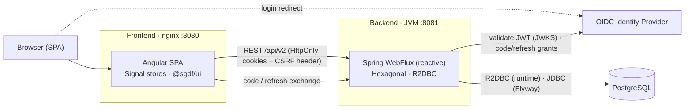

# Technical documentation

This section covers Registry's engineering: the two-service architecture, the reactive backend, the Angular frontend, the data model and API contracts, the security model, and the Architecture Decision Records (ADRs) that justify each choice. It assumes the [functional documentation](/registry/functional/) — in particular the [Roles and permissions](/registry/functional/roles-and-permissions) baseline — is understood.

## The system at a glance

Registry ships as **two independently versioned services** and two supporting infrastructure components:

The browser loads the SPA from nginx, which calls the backend over REST, authenticating with `HttpOnly` cookies rather than a token kept in JavaScript. Authentication is delegated to an external OIDC provider; the backend both validates JWTs (as a resource server) and orchestrates the code/refresh exchanges (as a confidential client). All state lives in a single PostgreSQL database. See [Security](/registry/technical/security) for the cookie/CSRF mechanics and the separate, unauthenticated management port that carries health, metrics and documentation.

## Documentation map

| Page                                                                              | Purpose                                                                                         |
| --------------------------------------------------------------------------------- | ----------------------------------------------------------------------------------------------- |
| [Getting started](/registry/technical/getting-started)                            | Run the whole stack locally: prerequisites, dependencies and configuration                      |
| [Architecture](/registry/technical/architecture)                                  | The hexagonal backend, the Angular frontend, and the end-to-end path of a request               |
| [Backend](/registry/technical/backend) · [Frontend](/registry/technical/frontend) | How each service is built, tested and configured                                                |
| [E2E tests](/registry/technical/e2e)                                              | The Playwright suite that checks user journeys in a real browser, and its conventions           |
| [Development conventions](/registry/technical/conventions)                        | The rules shared by the repositories: writing code, tests, reviews, branches and commits        |
| [Security](/registry/technical/security)                                          | Each security mechanism, what it is for and what it prevents (beginner-friendly)                |
| [Data model](/registry/technical/data-model)                                      | The PostgreSQL schema, entity relationships, history, audit and search                          |
| [API contract](/registry/technical/api-reference)                                 | The shared conventions of `/api/v2` and its organization by domain (the details are in OpenAPI) |
| [Glossary](/registry/technical/glossary)                                          | The technical terms, jargon and acronyms used in the documentation, with their definitions      |
| [ADR index](/registry/technical/adr/)                                             | All the Architecture Decision Records, in causal order                                          |

## Stack summary

Versions are given to the major version; the source repositories contain the exact versions.

| Layer         | Backend                                                                                    | Frontend                                                                  |
| ------------- | ------------------------------------------------------------------------------------------ | ------------------------------------------------------------------------- |
| Language      | Kotlin (JVM toolchain pinned by Gradle)                                                    | TypeScript                                                                |
| Framework     | Spring Boot · WebFlux (reactive)                                                           | Angular (standalone, zoneless)                                            |
| Architecture  | Hexagonal (ports and adapters), checked by ArchUnit                                        | core / pages / shared, stores loaded on demand per route                  |
| State / data  | R2DBC (reactive) + Flyway migrations                                                       | `@ngrx/signals` stores behind per-domain facades                          |
| UI            | —                                                                                          | `@sgdf/ui` web components + Tailwind CSS (layout only)                    |
| Auth          | OAuth2 resource server + confidential client (OIDC), HttpOnly cookies, stateless HMAC CSRF | `withCredentials` HTTP interceptor relaying the CSRF header, route guards |
| Traceability  | Audit log of access to personal data, _log_ history                                        | —                                                                         |
| Hardening     | Rate limiting, security headers, isolated management port                                  | nginx: nonce-based CSP, hardening headers                                 |
| API docs      | springdoc OpenAPI 3.0 (enabled by feature flag)                                            | —                                                                         |
| i18n          | Spring `MessageSource` (en, fr)                                                            | Transloco (fr, en)                                                        |
| Observability | Actuator + Micrometer/Prometheus                                                           | —                                                                         |
| Build         | Gradle (Kotlin DSL)                                                                        | Angular CLI + pnpm                                                        |
| Runtime image | Distroless Java, non-root, JVM jar                                                         | Unprivileged nginx serving the static bundle                              |
| Persistence   | PostgreSQL (`pg_trgm` trigram search)                                                      | —                                                                         |
| Release       | semantic-release → GHCR (retention of 5)                                                   | semantic-release → GHCR (retention of 5)                                  |
