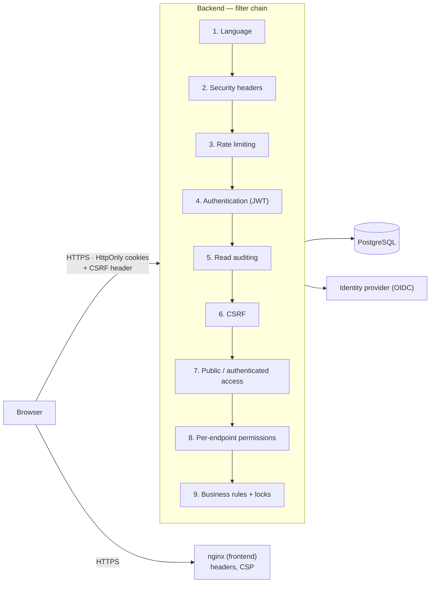
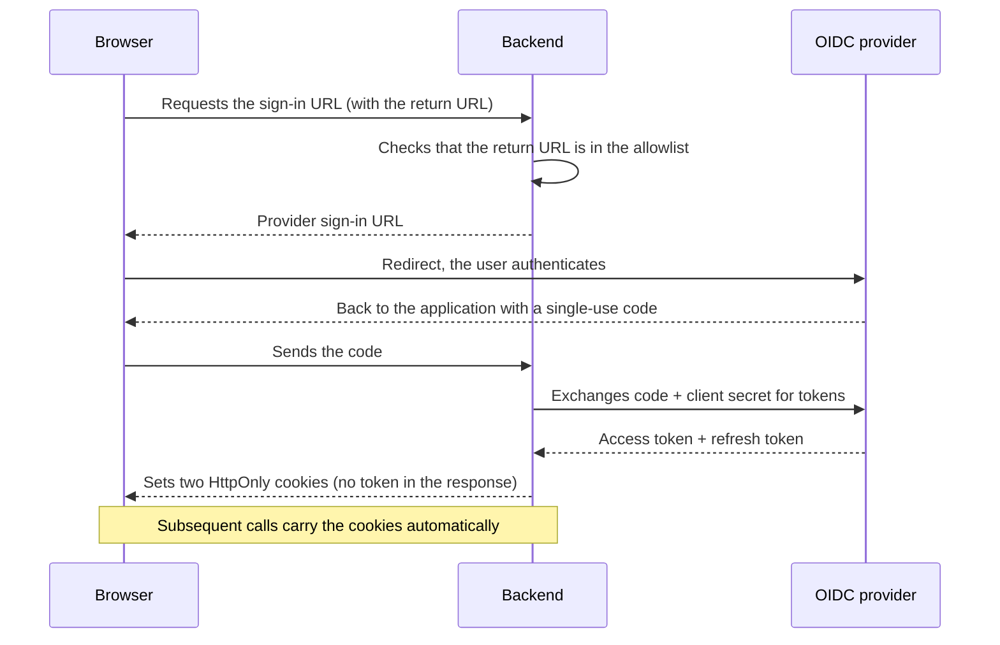
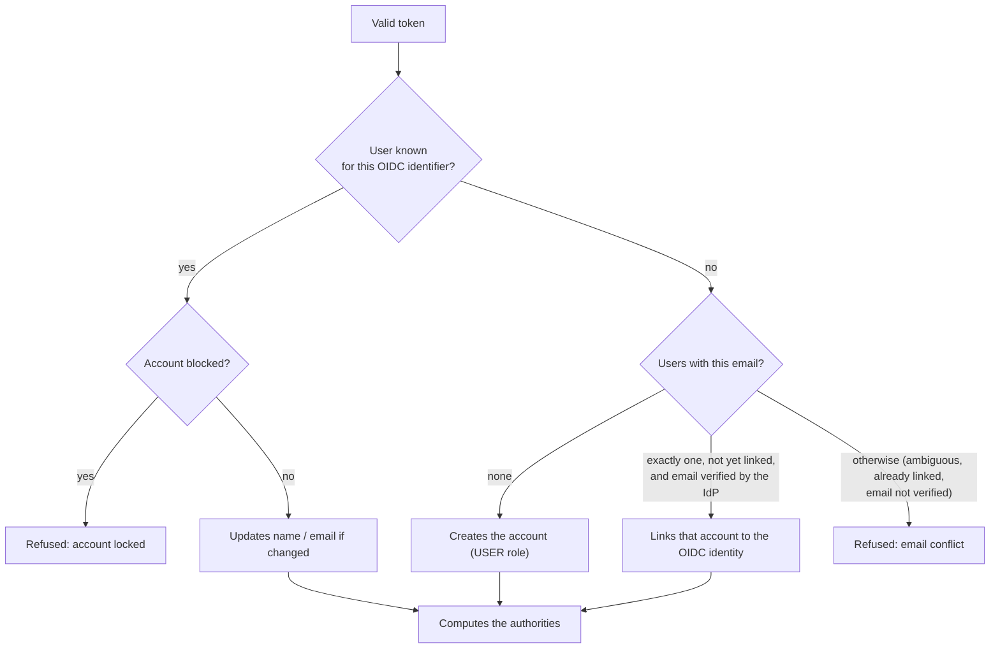

# Security

This page explains **each Registry security mechanism, what it is for and what it prevents**. It is also aimed at readers new to web security: each section starts with the problem to solve, before describing the chosen solution. The roles and the business matrix are in [Functional → Roles and permissions](/registry/functional/roles-and-permissions); this page is their technical view.

::: tip The guiding principle: defense in depth
No mechanism is assumed to be infallible. Each request goes through several independent barriers (network, identity, permissions, business rules, database), so that a mistake in one of them is not enough to open a breach. The frontend, on the other hand, is **never** a barrier: everything it hides or blocks is re-checked by the backend.
:::

## Overview



| Layer                 | Question it answers                                     | Mechanisms                                                  |
| --------------------- | ------------------------------------------------------- | ----------------------------------------------------------- |
| Network and transport | Who can reach what, and is the communication encrypted? | HTTPS + HSTS, isolated management port, CORS                |
| Identity              | Who is the caller?                                      | Delegated OIDC, verified JWT, `HttpOnly` cookies            |
| Session integrity     | Does the request really come from our application?      | Stateless CSRF, `SameSite`, redirect allowlist              |
| Authorization         | Are they allowed to do _this_, _in this project_?       | Two-plane RBAC, per-project namespaces, options, visibility |
| Business rules        | Does the action leave the data in a valid state?        | Validation, last-administrator safeguards, row locks        |
| Abuse                 | Is someone trying to abuse the service?                 | Rate limiting, input bounds                                 |
| Traceability          | Who accessed personal data, and when?                   | Audit log, _log_ versioning                                 |
| Data                  | Do we keep only what is needed?                         | GDPR export, deletion, retention purges                     |
| Browser               | Can a booby-trapped page hijack the application?        | Nonce-based CSP, hardening headers                          |
| Runtime               | Can an attacker who gets in go far?                     | Minimal non-root images, secrets outside the image          |

## 1. Authentication: knowing who the caller is {#authentication}

### Delegating rather than storing passwords

**The problem.** Storing passwords means hashing them properly, handling resets, two-factor authentication, brute-force detection… It is a huge attack surface, with no added value for Registry.

**The solution.** Registry knows **no password**. Authentication is entrusted to an external **OIDC identity provider** (Authentik locally, the organization's IdP in production). The provider proves _who_ the user is; Registry then decides _what they can do_ ([ADR 004](/registry/technical/adr/004-oidc-resource-server-auth)).

The backend plays two OAuth2 roles:

- **Confidential client**: it is the backend, not the browser, that exchanges the authorization code for tokens with the provider. The **client secret** therefore stays on the server and never appears in JavaScript code.
- **Resource server**: on every call, it verifies the presented token before doing anything.



### Verifying the token on every request

A token can be stolen, expired, or issued for another application. The backend therefore checks, on every call:

| Check                                                                                              | What it prevents                                                        |
| -------------------------------------------------------------------------------------------------- | ----------------------------------------------------------------------- |
| **Signature** (the provider's public keys, fetched and cached)                                     | A token forged or modified by an attacker                               |
| **Expiry**                                                                                         | Reuse of an old stolen token                                            |
| **Audience**: the token must be intended for a trusted Registry client                             | Use of a token issued by the same provider for _another_ application    |
| **Issuer**: scheme, host and port must match the configured origin **exactly** (not just a prefix) | A token issued by a fake provider whose address looks like the real one |

Outbound calls to the provider (code exchange, refresh, revocation) go through a **bounded** HTTP client: capped number of connections and connection and response timeouts. A slow or failing provider makes the request fail quickly ("failed dependency" error) instead of tying up all the server's resources.

### From token to Registry user {#jwt-→-application-user}

The token proves an identity at the provider; it still has to be linked to a Registry user. A dedicated converter takes care of this:



Important security points:

- **Linking by email only if the email is verified.** A pre-created account (for example by an email invitation) is only linked to an OIDC identity if the provider certifies the address (`email_verified`). Without this rule, someone could create an account at the provider with another person's address and take over their access.
- **A blocked account is refused on every request**, not just at sign-in.
- **The result is cached** for a few dozen seconds (60 s by default) so the authorities are not recomputed on every call. Any rights change made through the API (role change, blocking, profile, project deletion…) **immediately clears** the affected entry; the delay only matters for a change made outside the API.

## 2. Session: where the tokens live

### `HttpOnly` cookies rather than a token in JavaScript

**The problem.** If the access token is stored in the browser somewhere readable by JavaScript (`localStorage`, global variable), any script injected into the page (XSS flaw, compromised dependency) can read and exfiltrate it.

**The solution.** The backend puts the tokens in **two cookies** that JavaScript cannot read:

| Attribute      | Effect                                                                                                                                        |
| -------------- | --------------------------------------------------------------------------------------------------------------------------------------------- |
| `HttpOnly`     | The cookie is invisible to JavaScript: a malicious script cannot steal it.                                                                    |
| `Secure`       | The cookie only travels over HTTPS (can be disabled **only** in local development).                                                           |
| `SameSite=Lax` | The browser does not send the cookie on requests triggered by another site (booby-trapped form, image…), except top-level navigation.         |
| Path scope     | The refresh cookie is only sent to the authentication endpoints, never to the rest of the API. It is therefore exposed as little as possible. |

The frontend never reads or stores a token. The only use of browser storage is to remember the page to return to after sign-in.

On **sign-out**, the backend clears the cookies and **revokes** the tokens with the provider: a token copied before sign-out becomes unusable immediately, without waiting for it to expire.

Non-browser clients (Swagger UI, scripts, service account) can still present the token in an `Authorization: Bearer` header; the backend accepts it first, then falls back to the cookie.

### Stateless CSRF protection {#cookie-based-session-csrf-protection}

**The problem.** Since the browser sends cookies automatically, a malicious site could try to make a signed-in user perform an action (delete a participant…) without their knowledge. This is cross-site request forgery (CSRF).

**The solution.** Any request that **changes** data must present, in an `X-XSRF-TOKEN` header, a value another site cannot know:

1. The backend computes this value as a cryptographic fingerprint (HMAC-SHA256) of the access token, with a key derived from the client secret. Nothing is stored server-side: the expected value is recomputed on every request.
2. It sends it back in a response header; the frontend keeps it **in memory** and sends it back on subsequent requests.
3. A third-party site can neither read this header (blocked by CORS) nor compute the value (it knows neither the token nor the key).

Exempt are: read methods (`GET`, `HEAD`, `OPTIONS`), calls carrying a `Bearer` header (a third-party site cannot forge one) and the initial token exchange (there is no access token yet to derive the value from). A failed check answers `403`.

### Redirect URL allowlist

**The problem.** The sign-in and sign-out endpoints receive the URL to send the user back to. Without control, an attacker could craft a legitimate sign-in link that then sends to their own site ("open redirect"), for phishing or to capture the authorization code.

**The solution.** Accepted return URLs are listed **exactly** in the configuration (no wildcard, the trailing `/` counts). Any other value is refused, and the backend even refuses to start if the list is empty. The sign-in endpoint also accepts an optional `state` parameter, returned as-is by the provider, which the client can use to check that the return matches its own request.

### CORS: who can call the API from a browser

By default, the browser blocks calls from one site to another domain. CORS tells the browser which origins are allowed to call the API. Registry uses an **explicit allowlist** of origins (never `*`), with credentials allowed; only the necessary headers (CSRF, `ETag`, `Location`) are exposed to the frontend.

## 3. Authorization: deciding what the caller can do {#authorization}

### Two permission planes, stored as data

Roles and their permissions are **database rows**, injected by migrations and loaded into memory at startup ([ADR 005](/registry/technical/adr/005-db-driven-project-rbac)). There are two independent planes:

- **Global**: the permissions of the user's application role (for example "read the user directory", "create a project").
- **Per project**: for each profile that is **accepted** and **within its access window**, the project role's permissions, **prefixed with the project identifier** (`{projectId}_{PERMISSION}`). On top of that comes one authority per optional module enabled on the project.

**Why this prefix?** It makes **cross-project isolation** (multi-tenancy) mechanical: holding "create a movement" in project A produces the `A_…` authority, which can never satisfy a check on project B. Automated tests generate cross-access scenarios to check that no endpoint leaks another project's data.

### A rule on every endpoint

Each endpoint declares its access rule on its contract interface; an architecture test guarantees that no controller escapes it, hence that **no endpoint can ship without an authorization rule**. A rule typically combines:

1. **the module**: has the project enabled the relevant option (vehicles, activities, communications, alerts)? Otherwise, refusal whatever the role;
2. **the permission**: does the caller hold the required permission **on this project**?

```kotlin
@PreAuthorize(
  "hasPermission(#projectId, 'REGISTRY_PROJECT_OPTION_VEHICLE') && " +
  "hasPermission(#projectId, 'REGISTRY_PROJECT_VEHICLE_C')"
)
```

Rules that depend on data (export right for a participant linked to the caller, role ceiling, last administrator) are checked afterwards, in the domain services.

Tests also check that the permissions injected into the database match the code's constants and that every module-bound endpoint refuses a caller who has the permissions but not the option.

### Soft delete, restore and visibility {#visibility-gating}

Each resource has distinct permissions to **(soft) delete**, **restore** and **permanently delete** ([ADR 017](/registry/technical/adr/017-soft-delete-and-restore-permissions)):

| Action             | Effect                      | Who (in general)                        |
| ------------------ | --------------------------- | --------------------------------------- |
| Delete             | Hides the item (reversible) | administrator, coordinator, participant |
| Restore            | Makes it visible again      | administrator, coordinator              |
| Permanently delete | Erases it from the database | administrator                           |

The **restore** permission also serves as the **visibility key**: only those who hold it can list or view deleted items. For everyone else, the backend silently forces the filter to "visible items", whatever parameter is sent. A participant therefore cannot discover a deleted item by editing the URL.

**Deleted project.** When a project is (soft) deleted, non-administrators no longer receive **any** authority on it, and the administrator keeps only read, restore and permanent deletion; module authorities are no longer granted. The project is frozen.

### Role safeguards

- **Role ceiling**: one can only assign, change, block or delete roles of a level equal to or lower than one's own. A coordinator can never create an administrator.
- **Last administrator**: the system refuses to remove, block, demote or delete the platform's last administrator, and a project's last **permanent** administrator (without an end date). A temporary profile, such as a support profile, never counts.
- **No action on oneself via the directory**: an administrator can neither block nor delete themselves through the administration screens.

These checks are made **under a row lock** (see [Concurrency](#concurrency)), so that two simultaneous requests cannot each remove the "second-to-last" administrator.

### Uniform response on denied access

Authentication and authorization failures produce a localized JSON error body (`401` not authenticated or invalid token, `403` insufficient permission or failed CSRF). On the frontend, an inaccessible project and a non-existent project show **the same** "project not found" message: a project's existence is not revealed to someone who has no access to it.

## 4. Data integrity {#data-integrity}

### Input validation

All incoming data is validated **before** it reaches the business logic:

- **Bounds** on every string, list and pagination parameter (capped page size, search text and sort limited in length, capped identifier lists); an oversized request body is refused (`413`). This prevents exhausting memory or the database with giant requests.
- **Declarative business constraints** (consistent dates, reason compatible with a movement's direction, option dependencies…).
- **Rules that depend on the database** in the services (item of the same project, item not deleted, adult participant to drive…).

Error messages are translated **stable codes**; internal messages and stack traces are **never** returned to the client, so as to reveal nothing about the inner workings.

SQL is written with **bound parameters** (never by string concatenation), which closes the door to SQL injection; sorting only accepts fields from a known list.

### Concurrency {#concurrency}

Several people edit the same project at the same time. Two protections prevent inconsistencies ([ADR 016](/registry/technical/adr/016-optimistic-concurrency-and-row-locks)):

- **Optimistic concurrency**: each read returns a "version tag" (`ETag`); an edit that sends it back (`If-Match`) is refused if someone changed the item in the meantime. This avoids silently overwriting a colleague's work.
- **Row locks**: the rows a rule depends on (administrators, group members, participants whose presence dates are being recomputed…) are locked in the transaction. Lock waits are bounded, and a protected update has a maximum duration: beyond that, the request fails cleanly rather than blocking.

### Versioning of _log_-type items {#log-history}

Alerts, check-ins/check-outs and communications are **traces** of real events. Before each change, the previous state is **archived** in a versioned history table ([ADR 018](/registry/technical/adr/018-log-history-versioning)). A correction therefore never makes what had been recorded disappear — this is what makes it possible to also allow correcting a definitive departure or a guest's check-out (for the latter, only the date): the effective presence dates that depend on them are recomputed in the same transaction.

## 5. Protection against abuse: rate limiting {#rate-limiting}

**The problem.** Without a limit, an attacker can hammer an endpoint: try authorization codes, extract the user directory address by address, request exports in a loop or create thousands of projects.

**The solution.** Four in-memory **sliding window** limiters ([ADR 012](/registry/technical/adr/012-per-instance-rate-limit-caffeine)):

| Limiter                                     | Counted per       | Default     | What it slows down                              |
| ------------------------------------------- | ----------------- | ----------- | ----------------------------------------------- |
| Token exchange and refresh                  | client IP address | 10 / minute | Brute force on the only unauthenticated surface |
| Personal data exports (user or participant) | user              | 5 / hour    | Mass extraction of personal data                |
| Search for a user to invite                 | user              | 30 / minute | Enumeration of the platform's directory         |
| Project creation                            | user              | 10 / hour   | Abusive project creation                        |

Beyond that, the response is `429 Too Many Requests` with a wait delay (`Retry-After`). An export refused for exceeding the limit is also **written to the audit log**. The number of tracked clients is capped, so that a flood of different addresses cannot saturate memory.

Moreover, the search for users to invite only works by **exact email address** (0 or 1 result): it is impossible to browse the directory by name fragments.

### Knowing the real IP address: trusted proxies

Behind a reverse proxy, all requests seem to come from the proxy's address. The `X-Forwarded-For` header gives the original address, but **any client can make it up**. Registry therefore only reads it if the connection comes from a **proxy declared as trusted** in the configuration, walking up the chain to the first untrusted hop. Without a configured proxy, only the connection address counts (and this is flagged at startup).

::: warning To configure behind a reverse proxy
Without a trusted proxy list, all clients share the proxy's address: the per-IP limit then becomes a global limit, and the audit records the proxy's address instead of the client's.
:::

Counters are specific to each instance and reset on restart; with N instances, the effective capacity is multiplied by N. This is an accepted trade-off as long as the backend runs as a single instance — and rate limiting at the reverse proxy level remains recommended in addition.

## 6. Traceability: the audit log {#audit}

**The problem.** Registry holds data about minors. It must be possible to answer, after the fact, "who viewed or exported this person's data, and when?", including for refused attempts.

**The solution.** A dedicated audit table records every access to personal data ([ADR 019](/registry/technical/adr/019-personal-data-access-audit)):

| Field    | Content                                                              |
| -------- | -------------------------------------------------------------------- |
| Action   | read or export                                                       |
| Resource | user, participant or movement (and its identifier if it is a record) |
| Project  | the project concerned, if any                                        |
| Actor    | the user who made the request                                        |
| Outcome  | succeeded, denied (`403`) or rate-limited (`429`)                    |
| Context  | real IP address and browser (User-Agent)                             |
| Date     | the instant of access                                                |

What is traced: reading the records and lists of users, participants (including birthdays, timelines and histories) and movements, as well as **every GDPR export**. The viewed **content** is never copied into the audit — only the fact that it was viewed.

Design choices:

- **Off the response path**: events go through an in-memory queue, written in the background. The audit does not slow the user down. In return, a full queue rejects the event (logging it) and an abrupt shutdown can lose pending events.
- **List deduplication**: list reads by the same user on the same resource produce only one event per window (60 s by default), otherwise the screens' automatic refresh would flood the audit. Reads of an individual record are **always** traced.
- **Limited duration**: the audit itself contains personal data (IP addresses). It is purged after 12 months by default, like the rest (see [Data retention](/registry/functional/features/data-retention)).

## 7. Personal data protection {#data-protection}

- **Right of access and portability.** Each user can export their own data; a platform administrator can export a user's; a project administrator can export a participant's (the user linked to that participant can too). Each export is traced and rate-limited. The interface reminds that the file must be deleted after it is sent.
- **Right to erasure.** Deleting a user or a participant is a **real deletion**, with no leftover anonymized row. Participants linked to a deleted user stay in their project, unlinked.
- **Minimization.** A participant can only be linked to a user who has (or had, or will have) a profile on their project: no arbitrary platform account can be attached to a project. Changing an existing participant's link requires `PARTICIPANT_HISTORY_R` (RP_A, RP_C); without it, one can only remove one's own link. This prevents linking oneself to participants in turn to export their data, which the export otherwise reserves for the project administrator.
- **Limited retention.** Nightly purges delete inactive accounts, abandoned projects, their content, their configuration and the audit beyond a threshold (12 months by default), with a "dry run" mode by default for manual triggers ([ADR 010](/registry/technical/adr/010-scheduled-retention-purges)). They require a permission that only the platform administrator (and the dedicated service account) holds.

## 8. Browser hardening {#browser-hardening}

These headers tell the browser how to protect itself.

### Frontend side (nginx)

| Header                                                        | Role                                                                                                                                                                                                                                                                                                                                                                                                                              |
| ------------------------------------------------------------- | --------------------------------------------------------------------------------------------------------------------------------------------------------------------------------------------------------------------------------------------------------------------------------------------------------------------------------------------------------------------------------------------------------------------------------- |
| `Content-Security-Policy`                                     | Lists what the page is allowed to load and run. Scripts and styles must come from the site itself **and** carry a **nonce** (a random value that differs on every page load): a script injected by an attacker does not have the right nonce and does not run. Network calls are limited to the site and to the backend's origin, read when the container starts. No `unsafe-eval`, no embedded objects, no embedding in a frame. |
| `X-Frame-Options: DENY` and `frame-ancestors 'none'`          | Forbid displaying the application in another site's `iframe` ("clickjacking").                                                                                                                                                                                                                                                                                                                                                    |
| `Strict-Transport-Security`                                   | Forces the browser to use only HTTPS for one year.                                                                                                                                                                                                                                                                                                                                                                                |
| `X-Content-Type-Options: nosniff`                             | Prevents the browser from "guessing" that a file is a script.                                                                                                                                                                                                                                                                                                                                                                     |
| `Referrer-Policy`                                             | Limits the URL information passed to other sites.                                                                                                                                                                                                                                                                                                                                                                                 |
| `Permissions-Policy`                                          | Disables geolocation, camera, microphone, payment and USB, which are useless here.                                                                                                                                                                                                                                                                                                                                                |
| `Cross-Origin-Opener-Policy` / `Cross-Origin-Resource-Policy` | Isolate the application's window and resources from other sites.                                                                                                                                                                                                                                                                                                                                                                  |
| `server_tokens off`                                           | Does not reveal the nginx version.                                                                                                                                                                                                                                                                                                                                                                                                |

Missing configuration files answer `404` (instead of the home page) and are never cached.

### Backend side

Each API response carries its own policy, independent of nginx: a CSP that allows **nothing** (`default-src 'none'`, a JSON API has nothing to load), a restrictive `Permissions-Policy` and HSTS. The Swagger documentation, when enabled, has a dedicated CSP that only allows the identity provider and the API.

## 9. Network exposure: the management port {#network-exposure-the-management-port}

The backend listens on **two ports**:

- the **API port**: everything described above applies to it;
- the **management port**: health, Prometheus metrics and, if enabled, the OpenAPI documentation. It has **no authentication**, by design.

::: danger Never expose the management port to the Internet
Its protection is the network: it must stay out of any public ingress, reachable only from the inside (health probe, metrics scraping). The API documentation is disabled by default and should only be enabled in development.
:::

## 10. Runtime and supply chain {#safe-defaults-hardening}

- **Minimal, rootless images.** The backend runs in a _distroless_ image (no shell or package manager) under a non-root user; the frontend in an unprivileged nginx. An attacker exploiting a flaw would have very few tools and rights.
- **Secrets outside the image.** The database password and the OIDC client secret are supplied by the environment. A missing required variable **makes startup fail** instead of taking a dangerous default value.
- **Safe startup by default.** `Secure` cookies, documentation disabled, mandatory redirect list: relaxing a protection takes an explicit action.
- **Monitored dependencies.** Code analysis (CodeQL) and dependency updates (Dependabot) run in CI; vulnerable frontend dependencies are overridden to patched versions.

## 11. What the frontend does — and does not do

The frontend **mirrors** authorization to offer an interface without dead ends: route guards (sign-in, global authority, project context, enabled option), buttons hidden according to rights. These are usability aids, **not protections**: each condition is re-checked by the backend, and a user who bypassed the interface would hit a refusal.

On the other hand, it contributes to security through what it **forbids itself**: no token in JavaScript, browser access (`window`, `document`, storage) centralized in a single service, no HTML injected without going through Angular's sanitization, and a CSRF token kept only in memory.

## Glossary

The acronyms and terms on this page (OIDC, JWT, CSRF, CSP, RBAC…) are defined in the [Glossary](/registry/technical/glossary#security).
